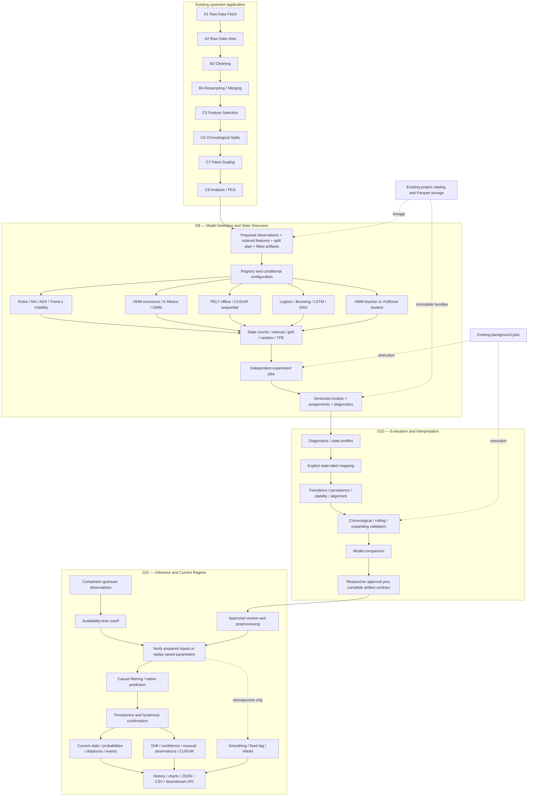

# Quantmetrics Lab architecture

The D9–D11 replacement follows the supplied [reference diagram](mermaid-diagram.png).

Data access, models, experiments, evaluation, interpretation, inference, visualization and export remain separate modules within the existing application architecture.
